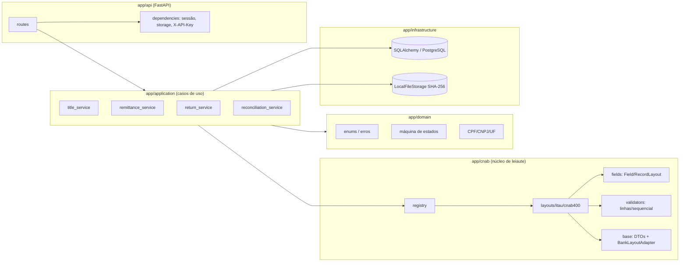
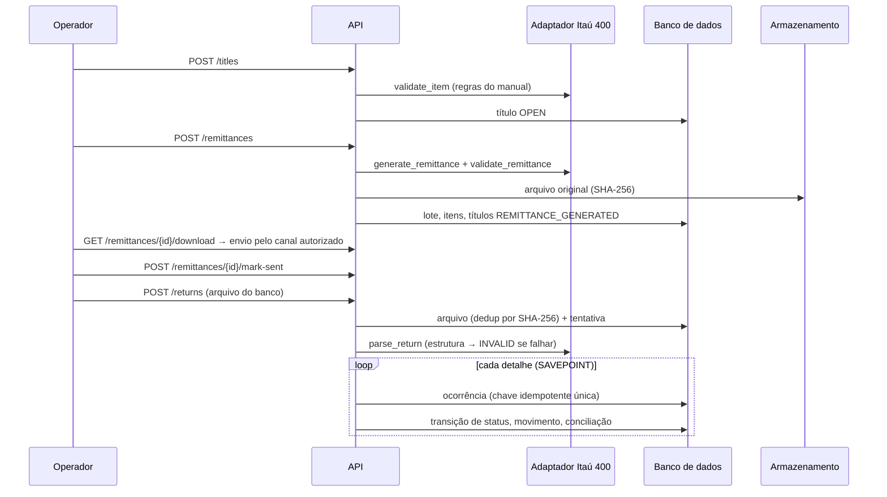
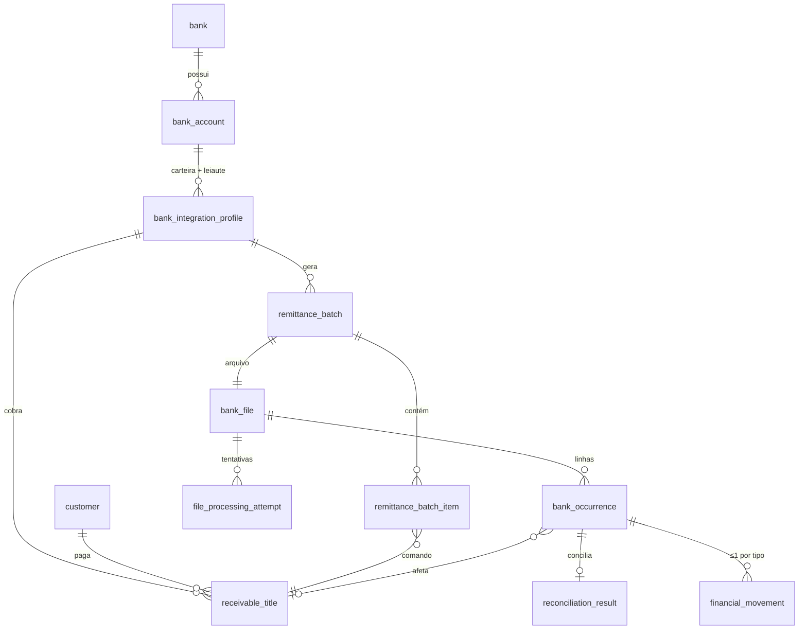
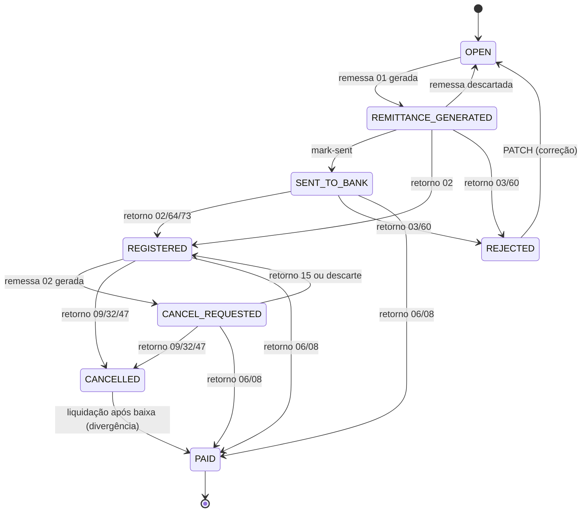

# Arquitetura

## Camadas

Dependências apontam para dentro. O domínio não conhece banco de dados nem leiaute. Os
adaptadores trocam apenas DTOs (`app/cnab/base.py`) e não conhecem o ORM. A conciliação recebe
o `ReturnDetail` já interpretado, sem depender do parser físico.

## Ciclo remessa → retorno

## Modelo de dados

Restrições relevantes:

* `bank_file.dedup_key` é único: um arquivo de retorno não é reimportado.
* `bank_occurrence.idempotency_key` é único: é o SHA-256 do layout mais as posições 1-394, sem o
  sequencial. O mesmo evento reenviado em outro arquivo é ignorado.
* `financial_movement (occurrence_id, kind)` é único: no máximo um movimento de cada tipo por
  ocorrência.
* `receivable_title (profile_id, nosso_numero)` e `company_reference` são únicos.
* `receivable_title.version` serve de trava otimista (`version_id_col`).
* `bank_integration_profile (bank_account_id, wallet)` é único: a resolução de perfil no
  retorno é determinística.
* Valores monetários: `NUMERIC(15,2)` (tipo `Money`), sem arredondamento silencioso.

## Máquina de estados do título (regra interna)

`OVERDUE` não é persistido. A API o expõe como `is_overdue` (título `REGISTERED`/`SENT_TO_BANK`
com vencimento passado), porque é uma condição temporal e não um evento confirmado pelo banco.
Transições não previstas viram `REVIEW_REQUIRED` na ocorrência, sem alterar o título.

## Transações e falhas

* A remessa é gerada numa única transação. Se o arquivo gerado não passa no validador do
  próprio adaptador, nada é persistido.
* No retorno, o arquivo original é gravado e confirmado antes do processamento. Cada linha roda
  num SAVEPOINT. Uma falha numa linha não desfaz as outras; o arquivo fica
  `PARTIALLY_PROCESSED`, e `POST /returns/{id}/reprocess` processa só o que faltou.
* Concorrência: as restrições únicas acima protegem contra reimportação simultânea. A alocação
  de nosso número usa `SELECT ... FOR UPDATE` no perfil.
